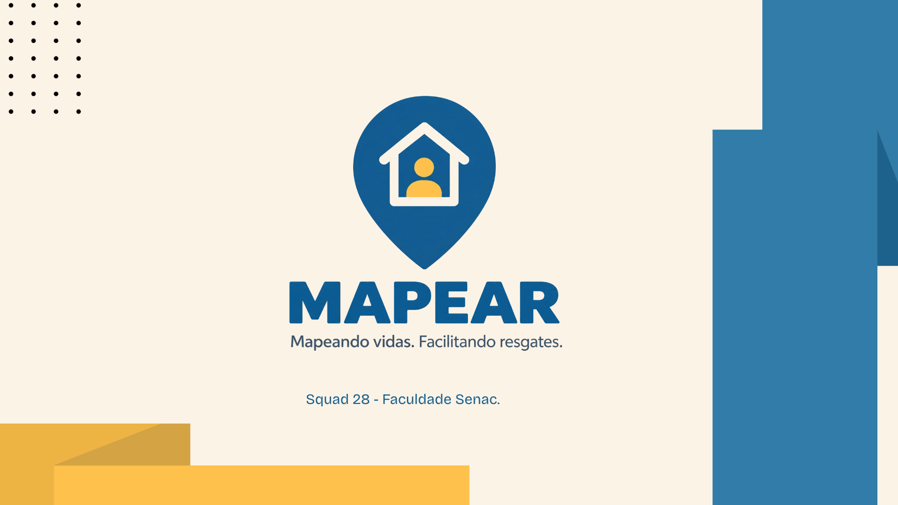
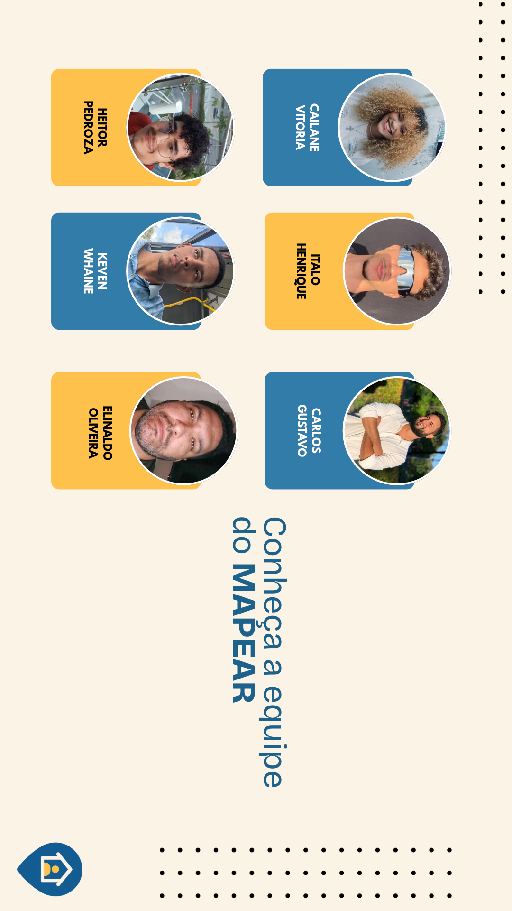

# 🗺️ Mapear

### Mapeando vidas. facilitando resgates.

  

## 🏛️ Apresentação do projeto

O **Mapear foi apresentado na residência do Porto Digital pelo o Squad 28** como parte de uma atividade acadêmica desenvolvida no SENAC Recife.

A apresentação teve como objetivo compartilhar a proposta de solução para apoiar a identificação e a organização da assistência a pessoas com mobilidade reduzida durante enchentes, deslizamentos e outras situações de calamidade.

## 📌 Sobre o projeto

O **Mapear** é uma proposta de aplicativo que busca apoiar a identificação e a organização da assistência a pessoas com mobilidade reduzida durante enchentes, deslizamentos e outras situações de calamidade.

A proposta considera pessoas cadeirantes, acamadas, idosas, cegas e outras pessoas que podem enfrentar dificuldades para sair de suas residências em segurança durante uma emergência.

Por meio de um cadastro voluntário e de um mapa acessível a agentes autorizados, o Mapear pretende auxiliar a Defesa Civil e outros órgãos responsáveis na identificação de pessoas que podem precisar de assistência, contribuindo para o planejamento e a organização das ações de resposta.

## 🚨 O problema

Durante enchentes, deslizamentos e outras calamidades, pessoas com dificuldade de locomoção podem enfrentar obstáculos para sair de casa em segurança.

Sem apoio, orientação acessível ou transporte adequado, essas pessoas podem permanecer em suas residências e ficar expostas aos riscos da emergência.

O Mapear surge como uma proposta para ajudar a tornar essas pessoas mais visíveis no planejamento das ações de assistência.

## 💡 A solução

O Mapear propõe um sistema de cadastro voluntário e visualização de pessoas que podem precisar de assistência em situações de emergência.

A proposta é que agentes autorizados possam consultar as informações cadastradas e visualizar os registros em um mapa, apoiando a identificação de necessidades e a organização das ações pelos órgãos responsáveis.

O sistema não substitui os serviços de emergência nem garante o resgate. Seu objetivo é oferecer apoio informacional para a organização da resposta.

## 🎯 Objetivo

Contribuir para que pessoas com mobilidade reduzida sejam consideradas no planejamento e na organização das ações de assistência durante enchentes, deslizamentos e outras calamidades.

## 🗺️ Como funcionaria

1. A pessoa ou seu responsável realiza um cadastro voluntário.
2. São registradas as informações necessárias sobre a possível necessidade de assistência.
3. Agentes autorizados consultam os registros.
4. As informações são visualizadas em um mapa.
5. Os dados podem apoiar a organização das ações de resposta pelos órgãos responsáveis.

## 🎨 Protótipo

O protótipo do Mapear foi desenvolvido no Figma para representar a proposta de funcionamento do aplicativo.

🔗 [Acessar o protótipo no Figma](https://www.figma.com/design/HsLARx0UFINLdVl8ekR3Sh/Sem-t%C3%ADtulo?node-id=13-244&t=KxRKn5wMLGfFsBoD-1)

## 🎥 Pitch do projeto

Conheça a proposta do Mapear em nosso vídeo de apresentação de aproximadamente um minuto.

  <video src="https://github.com/user-attachments/assets/80bd6c12-c806-45b2-8457-77faaedcaf9c" width="300" controls></video>

## 👥 Equipe responsável

  

| Integrante | Responsabilidade |
|---|---|
| Keven Whaine | Coordenação geral da equipe, Figma, protótipo Navegável, pesquisas, jornada do usuário, mapa de empatia, fluxo de telas e apoio geral |
| Cailane Vítoria | Apresentadora, Organização do Slide, Criação da logo, Patelas de cores, pitch em vídeo e Apoio geral |
| Ítalo Henrique | Ideia do projeto, Personas, ideias para o protótipo e apoio geral |
| Elinaldo Oliveira | Análise de concorrentes, Referencias e pesquisas, lean canvas e Apoio Geral  |
| Carlos Gustavo | Apresentador, Matriz CSD e Apoio Geral |
| Heitor Pedroza | Referências e pesquisas, organização do Slide e apoio geral|

---

  <strong>Mapear</strong> 
  Para que, em uma situação de emergência, as pessoas que precisam de assistência também sejam consideradas.

